<div align="center">

# 🛡️ Raahi

### Smart Tourist Safety System


**A practical Android app that brings travel assistance, location awareness, and emergency response tools into one place.**

[](https://flutter.dev)
[](https://www.android.com/)
[](https://supabase.com)
[](LICENSE)

</div>

## About Raahi

Raahi is a mobile safety companion for tourists and travellers. It helps users keep important travel and identity information together, monitor their location, contact trusted people during an emergency, and get travel or safety guidance from an AI assistant.

The app is designed around a local-first approach. Core screens, saved contacts, emergency history, and cached information remain available when the internet is unavailable. Features that require a cloud service, such as account authentication, cloud synchronisation, and AI responses, become available again when connectivity returns.

## What Raahi can do

### 🚨 Emergency response

- Send an SOS alert from the dashboard.
- Trigger an SOS confirmation prompt by shaking the phone while using the dashboard.
- Send a location-based SMS directly to every saved personal emergency contact.
- Attempt to call India's emergency number, **112**, after an SOS request.
- Provide separate medical, security, and location-sharing alert flows.
- Store emergency activity in local history for later reference.

> Emergency SMS and calling depend on the device, SIM, carrier, permissions, and network availability. A successful request from the app does not guarantee that a message was delivered or that an emergency call was answered.

### 📍 Location and travel awareness

- Track the user's route using the device GPS.
- Display the route on an OpenStreetMap-based map.
- Save route points and the last known location locally.
- Share a Google Maps location link in emergency messages.
- Discover useful nearby travel, medical, food, and transport services where configured.

### 🪪 Digital tourist profile

- Maintain a tourist profile with basic identity and travel information.
- View a digital tourist ID.
- Manage emergency contacts.
- Support English and Hindi on the main dashboard, navigation labels, and important safety actions.

### 🤖 Raahi AI assistant

- Ask travel, safety, and destination-related questions.
- Use text, voice input, and image-based assistance where supported.
- Receive safety-oriented responses through a protected Supabase Edge Function.
- Keep the provider API key on the server instead of inside the mobile application.

## Screenshots

<div align="center">
  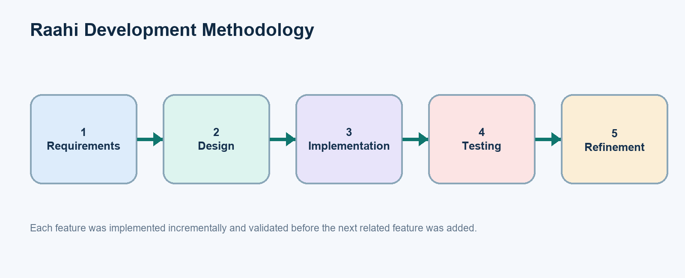
  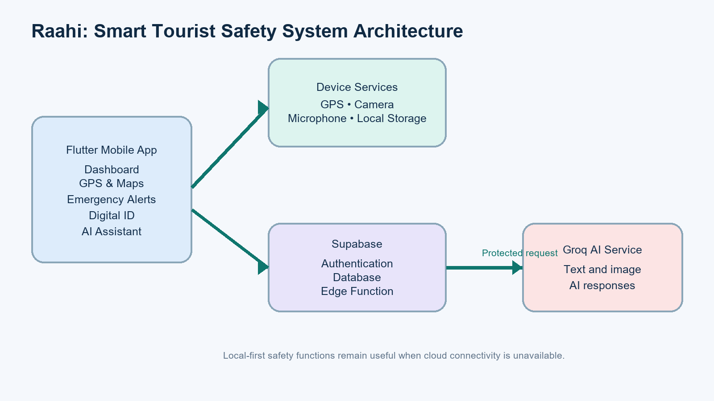
  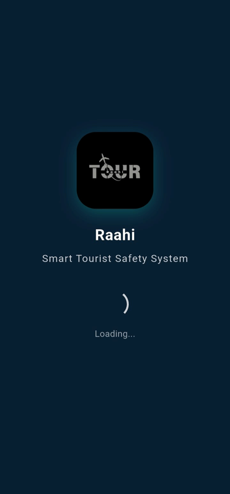
  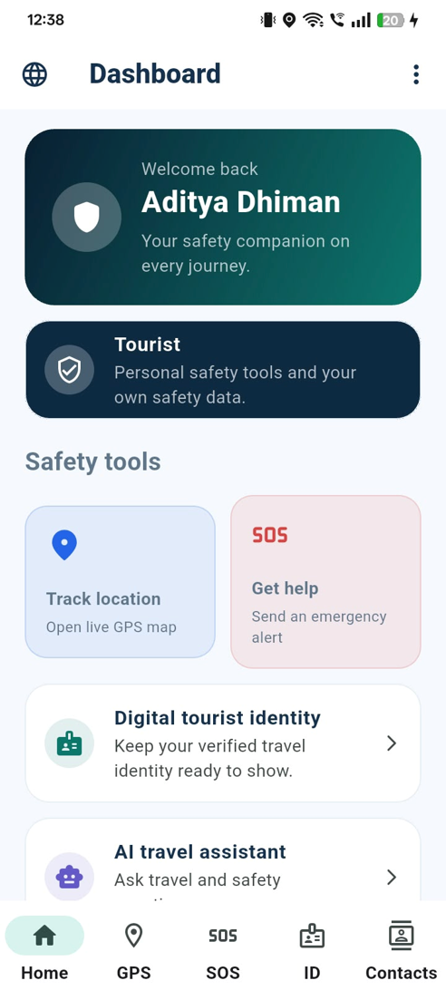
</div>

<div align="center">
  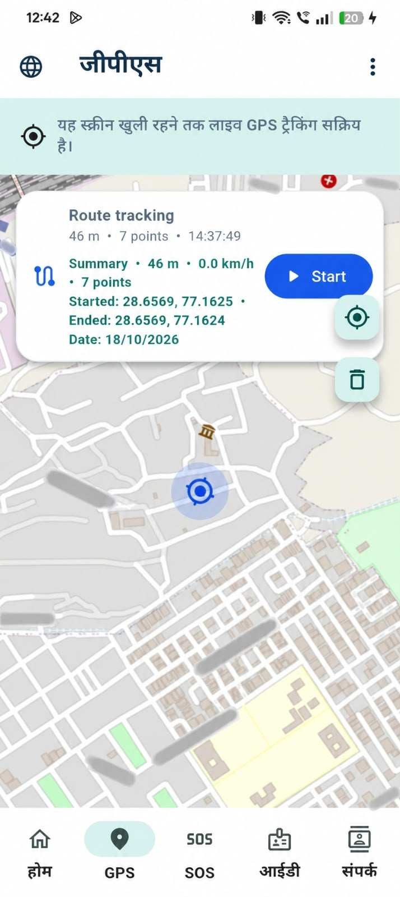
  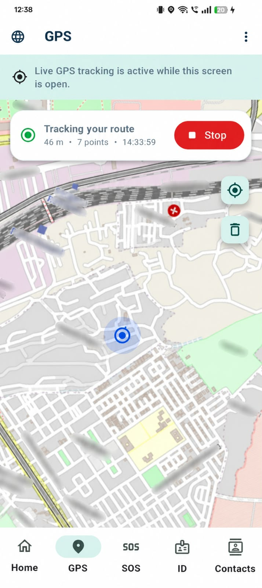
  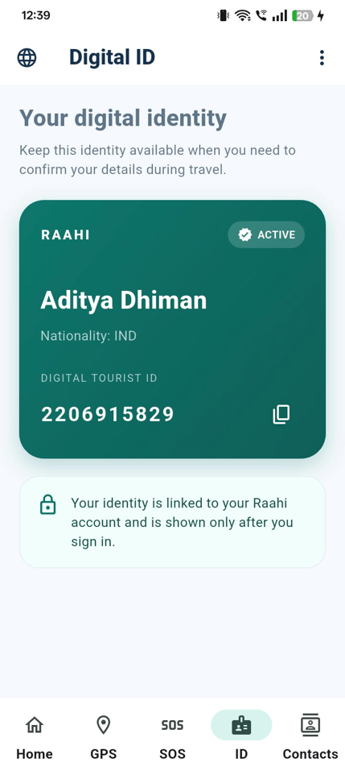
  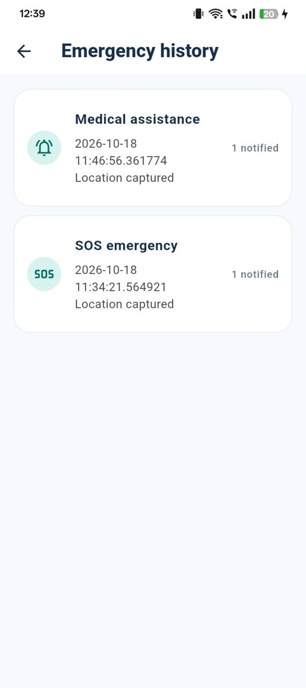
</div>

<div align="center">
  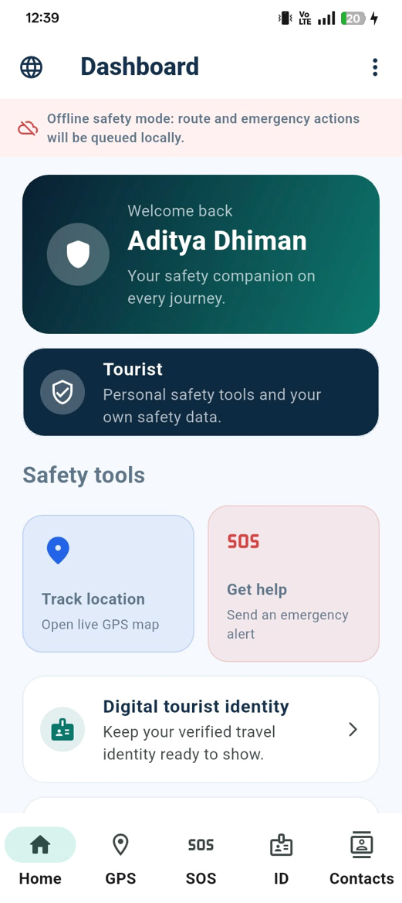
  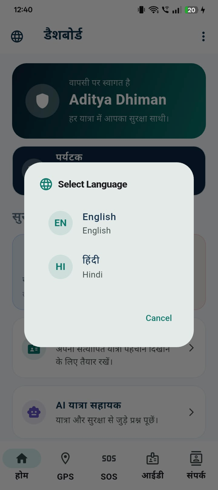
  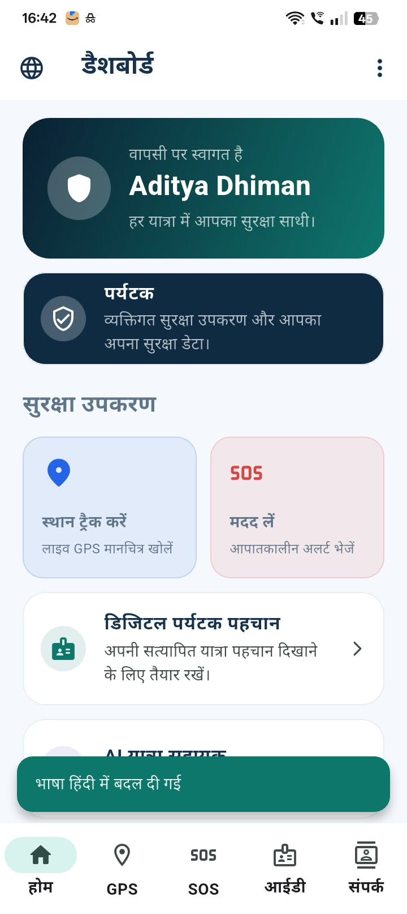
  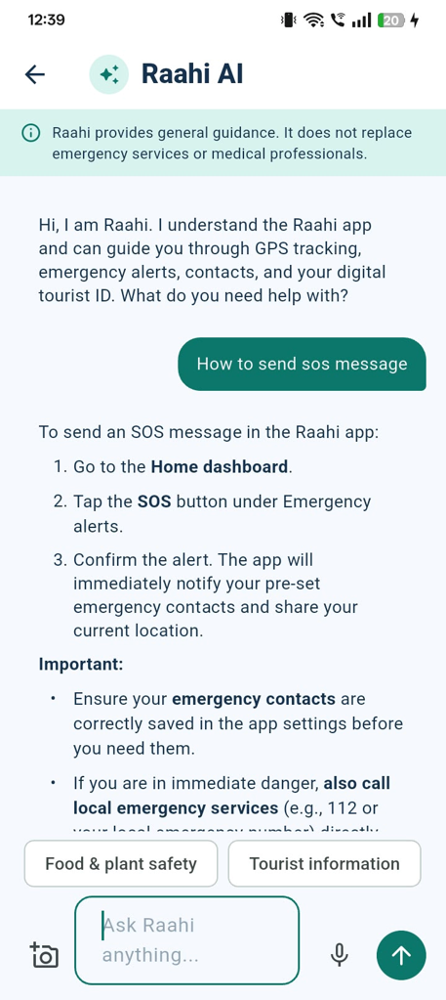
</div>

<div align="center">
  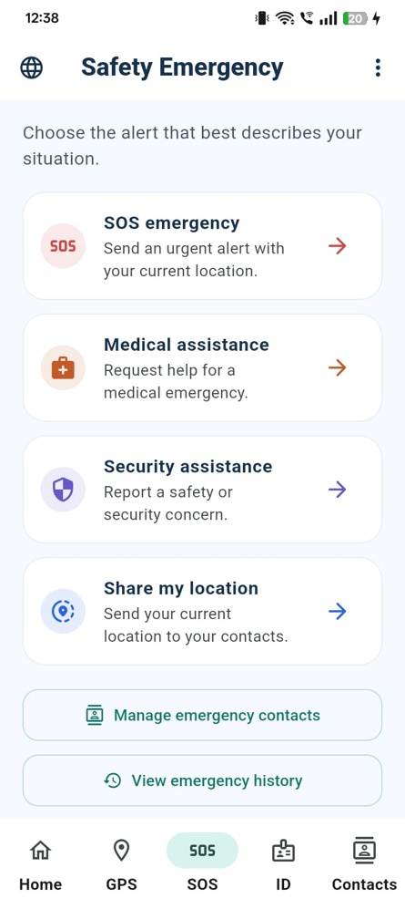
  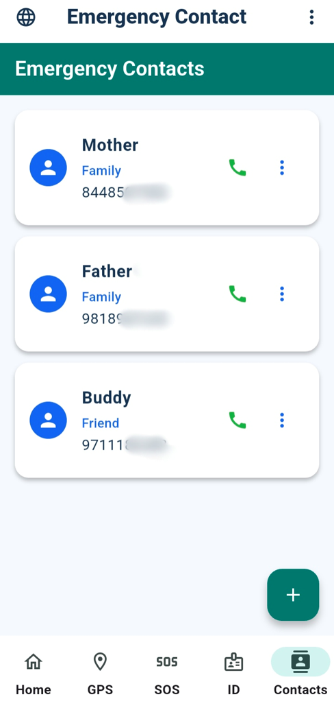
  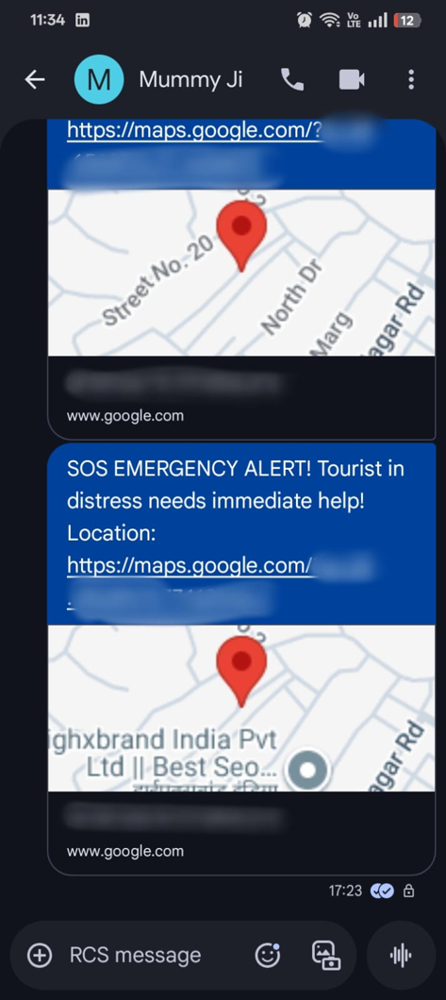
</div>

## How it works

1. The user signs in and completes a basic tourist profile.
2. Emergency contacts and travel information are saved locally and synchronised with Supabase when possible.
3. The dashboard provides quick access to GPS tracking, emergency actions, the digital ID, services, and the AI assistant.
4. During an SOS event, Raahi gets the best available location, sends an individual alert to each saved contact, and attempts the 112 emergency call.
5. If cloud connectivity is unavailable, local safety data and queued actions remain available for later synchronisation.

## Technology

| Area | Technology |
| --- | --- |
| Mobile application | Flutter and Dart |
| State and UI updates | Provider and Flutter widgets |
| Authentication and database | Supabase Auth and PostgreSQL |
| Server-side AI gateway | Supabase Edge Function |
| AI provider | Groq text and vision models |
| Maps and route display | `flutter_map`, OpenStreetMap tiles, `latlong2` |
| GPS | `geolocator` |
| Offline persistence | SharedPreferences and local cached data |
| Emergency SMS | Android `SmsManager` through a Flutter platform channel |
| Emergency calling | Android `TelecomManager` through a Flutter platform channel |
| Device features | Camera, microphone, speech input, and accelerometer |

## Project structure

```text
lib/
├── main.dart
├── dashboard_page.dart
├── rahi_chat_screen.dart
├── emergency_history_screen.dart
├── privacy_security_screen.dart
├── services/
│   ├── emergency_alert_service.dart
│   ├── rahi_ai_service.dart
│   ├── supabase_auth_service.dart
│   ├── supabase_data_service.dart
│   ├── supabase_service.dart
│   └── user_session.dart
├── widgets/
│   └── simple_map_widget.dart
└── l10n/

android/app/src/main/
├── AndroidManifest.xml
└── kotlin/com/example/raahi/MainActivity.kt

supabase/functions/rahi-chat/
└── index.ts
```

## Getting started

### Requirements

- Flutter SDK 3.8 or later
- Dart SDK compatible with the installed Flutter version
- Android Studio or VS Code
- Android SDK and a physical Android device or emulator
- A Supabase project for authentication, database features, and the AI Edge Function

### Installation

```bash
git clone https://github.com/Aditya-Dman/Raahi.git
cd Raahi
flutter pub get
flutter run
```

### Supabase and AI configuration

1. Create a Supabase project.
2. Configure the project values using the app's Supabase configuration pattern.
3. Apply the relevant SQL files from [`migration/`](migration/).
4. Configure the `GROQ_API_KEY` secret for the `rahi-chat` Edge Function.
5. Deploy the Edge Function before using AI features.

Never commit real API keys, service-role keys, or private credentials to the repository. Cloud features may be unavailable until the project is configured, but the application should still be able to start and show locally cached data for a previously logged-in user.

## Testing and validation

Run the Flutter test suite with:

```bash
flutter test
```

Build a debug Android APK with:

```bash
flutter build apk --debug
```

For real-device validation, test GPS permissions, SMS permissions, multiple emergency contacts, shake detection, offline startup, and emergency-call behaviour carefully. Do not place an unnecessary test call to 112.

## Current scope

Raahi is an Android-focused MVP. Availability of emergency communication depends on Android permissions and device/carrier support. The app provides route tracking and location visualisation; it is not a turn-by-turn navigation system. Cloud synchronisation and AI assistance require internet access.

## Contributing

Issues and improvements are welcome. Please keep changes focused, avoid committing secrets or generated build output, and run the relevant Flutter tests before opening a pull request.

## License

This project is available under the [MIT License](LICENSE).

<div align="center">
  <strong>Built with Flutter for safer, more informed travel.</strong>
</div>
